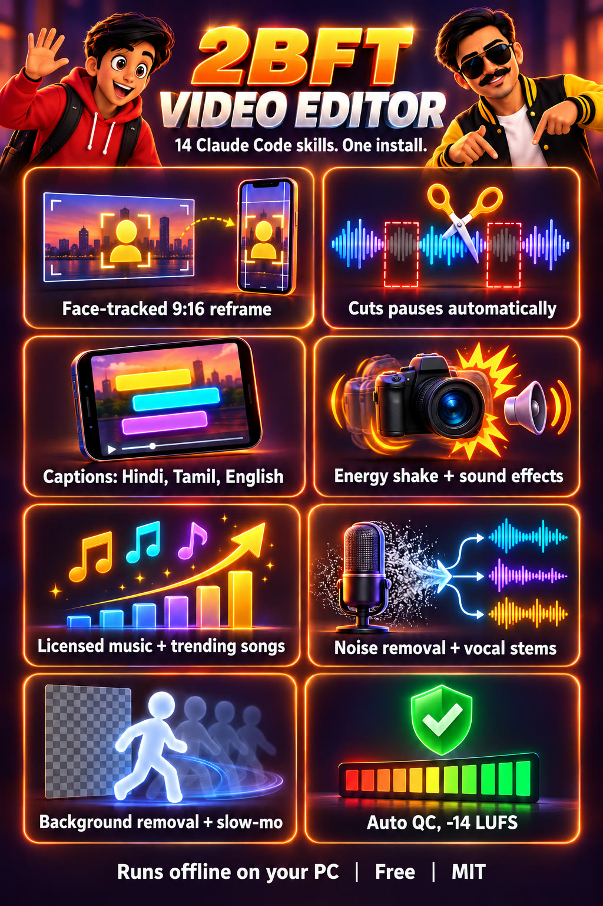

<p align="center"></p>

# 2BFT Video Editor: Claude Code video editing skills with face-tracked auto reframe

**2BFT Video Editor is an open-source pack of 14 Claude Code skills that edits talking-head, webcam and live-stream footage into YouTube videos and 9:16 Shorts, with face-tracked auto reframe.** It runs on your own PC, free, MIT licensed.

**A video editor for Claude Code that keeps your face in frame.** Hand Claude a raw recording and it reframes it to 9:16 with a crop that follows your face, then cuts the pauses, adds energy-reactive shake, captions, sound effects and music, and masters to -14 LUFS. It also finds licensed music, SFX and this week's trending songs, and cleans sound offline: noise removal, vocal and music stems, karaoke, background removal, slow motion. Fourteen skills, one install, runs on your own PC.

[](LICENSE)    

<p align="center"></p>

*Left: a fixed crop loses the speaker when he stands and leans. Right: `reframe.py` follows the face. Real webcam footage from one of our streams, not staged. Full-quality video: [`media/demo.mp4`](media/demo.mp4).*

## Install in 1 minute

```bash
npx skills add 2boysfromtown/2bft-video-editor --global --agent claude-code
```

Or as a Claude Code plugin:

```bash
claude plugin marketplace add 2boysfromtown/2bft-video-editor
claude plugin install 2bft-video-editor@2bft
```

Then the Python side:

```bash
pip install numpy "opencv-python>=4.8"
```

Download the face model `face_detection_yunet_2023mar.onnx` from the [OpenCV model zoo](https://github.com/opencv/opencv_zoo/tree/main/models/face_detection_yunet) and point `REFRAME_YUNET` at it. You need ffmpeg on PATH. Then tell Claude:

> Reframe this to a vertical Short that follows my face: `C:\videos\stream.mp4`

## Auto reframe to 9:16 with face tracking (try it without Claude)

```bash
python -I skills/2bft-video-editor/scripts/reframe.py in.mp4 out_9x16.mp4                      # whole frame -> 9:16
python -I skills/2bft-video-editor/scripts/reframe.py stream.mp4 cam.mp4 --region 1476,154,384,768 --zoom 1.7   # just the webcam box, closer
python -I skills/2bft-video-editor/scripts/reframe.py in.mp4 compare.mp4 --compare --dur 20    # static vs tracked, side by side
```

## Sound and clean-up, offline (new in v0.3)

```bash
python -I skills/local-av-tools/scripts/denoise.py talk.mp4                # fan, AC, traffic, hum gone -> talk_clean.mp4
python -I skills/local-av-tools/scripts/stems.py stream.mp4 --two          # voice.wav + music.wav: pull music out from under your voice
python -I skills/local-av-tools/scripts/shots.py reference_reel.mp4 --sheet  # every cut, cuts per minute, contact sheet
python -I skills/asset-library/scripts/trending.py --top 20                # songs trending this week on Shorts, Spotify, JioSaavn and more
python -I skills/asset-library/scripts/find_assets.py sound "whoosh" --ad-safe   # free SFX you can use in a paid ad, with licence
```

## Results (measured, not estimated)

| Test | Result |
|---|---|
| Face found in a 20 s webcam clip with two face posters on the wall | 100 % of 200 samples |
| 5 s of 1080p to a 1080x1920 face-tracked Short, with audio | 5.7 s on CPU |
| 20 s side-by-side comparison render | 8.1 s on CPU |
| A 68-minute two-person stream edited with this pack | a 38-minute YouTube cut at -14.0 LUFS plus 13 Shorts |
| Mic noise removal (DeepFilterNet, CPU) | 30 s of speech cleaned in 2 s |
| Stems (Demucs v4) | vocals, drums, bass, other from a 30 s song in 25 s on an RTX 5070 Ti |
| Karaoke (singing removed) | 5-minute song in 55 s; Whisper heard 72 words in the original, 1 in the karaoke track |
| Shot detection (TransNetV2) | 62 shots found in a 7.3-minute edit in 22 s, every cut matched the contact sheet |
| Trending check | 30 India and global charts read in about 13 s |

Worked example: [`examples/face-reframe`](examples/face-reframe).

## What's in the pack

<p align="center"></p>

**Face tracking first**
- **`2bft-video-editor`** (start here): the entry skill and `reframe.py`. Face-tracked reframe to 9:16, 4:5 or 1:1, with a "camera operator" smoothing chain (gap fill, median, Gaussian, deadzone) so the crop moves like a person, not a jittery tracker. Picks the real face over posters and photos.
- **`quest-lab-editor`**: our full stream-to-video engine. Webcam crops that follow the face, energy-reactive camera shake measured from voice and movement, quest HUD graphics, kinetic Hinglish or English captions, SFX and echo by rule, music cut to drops, pause tightening from the measured noise floor, Netflix-style subtitle checks and automatic pre-delivery QC (black, frozen, silent, loudness, flash safety).

**Sound, music and assets**
- **`asset-library`**: about 400 checked sources for sound effects, meme sounds, royalty-free and Indian music, songs trending now (YouTube Shorts India, Spotify, Apple Music, JioSaavn, Gaana), meme clips and GIFs, stock footage, LUTs, Tamil and Devanagari fonts, icons and Lottie. Each row has its licence, credit rule and whether it is safe in a paid client ad. Scripts: `find_assets.py` (no-key search across about 20 sources), `trending.py` (30 charts with a "hot in India" verdict), `fetch_asset.py` (downloads with a licence sidecar and a credits log).
- **`local-av-tools`**: offline clean-up with small open models. `denoise.py` (DeepFilterNet), `stems.py` (Demucs v4), `karaoke.py` (BS-RoFormer), `shots.py` (TransNetV2), `track.py` (MediaPipe face, smile, blink, pose, hands), `diarize.py` (pyannote, who speaks when), `interpolate.py` (RIFE / FILM smooth and slow motion), `cutout.py` (BiRefNet background removal, ProRes 4444 alpha). Plus notes on driving DaVinci Resolve through Blackmagic's official MCP and the free add-ons we use (AutoSubs, Reactor, ReaPlugs).

**Editing craft**
- **`editor-os`**: eight edit styles, pacing targets in cuts per minute, a sound cue-sheet method, `pacing_report.py`.
- **`edit-video`**: intake, look, plan, rough cut, pacing, sound, export, QA.
- **`video-editing-craft`**, **`comedy-editing-timing`**, **`video-sound-and-music`**, **`motion-graphics-for-video`**: the decisions behind good cuts, jokes, mixes and graphics.
- **`ffmpeg-edit-toolkit`**: tested ffmpeg recipes plus `remove_silence.py` (automatic jump cuts) and `make_sfx.py`.
- **`transcribe-local`**: offline Whisper transcripts with timestamps.
- **`long-to-shorts`**: long recording to captioned 1080x1920 Shorts with hook and CTA.
- **`talking-head-polish`**: text behind the speaker and karaoke captions.

## How it works

```
recording ──► transcribe (offline Whisper) ──► face track (YuNet, 10 fps) ──► smooth (gap fill → median → Gaussian → deadzone → Gaussian)
                                                                                         │
            plan (hook, beats, style) ◄── contact sheets + energy map ◄──────────────────┘
                     │
                     ▼
   cut → tighten pauses → reframe 9:16 on the face → captions → SFX + music → energy shake → -14 LUFS → QC
```

## How it compares

| | 2BFT Video Editor | Cloud auto-clip apps (e.g. Opus Clip) | Editor apps with auto reframe (e.g. CapCut, Premiere Pro) |
|---|---|---|---|
| Face-tracked 9:16 reframe | Yes | Yes | Yes |
| Runs inside Claude Code, driven by plain-English requests | Yes | No | No |
| Your footage stays on your PC | Yes | No (uploaded) | Depends on the app |
| Open source, you can change the rules | Yes (MIT) | No | No |
| Price | Free | Free tier, then paid | Free tier or paid |
| Polished drag-and-drop interface | No (you talk to Claude) | Yes | Yes |

Pick an app if you want buttons. Pick this if you already use Claude Code, want the edit to run on your own machine, and want to change how it cuts.

## FAQ

**What is the best Claude Code skill for video editing?**
For talking-head, webcam and stream footage, this pack: one install gives Claude a full workflow (watch, transcribe, plan, cut, reframe, captions, sound, QC) plus face-tracked auto reframe. For animation and motion graphics built in code, also look at Remotion's own skills.

**How do I auto reframe a 16:9 video to 9:16 with face tracking for free?**
`python -I skills/2bft-video-editor/scripts/reframe.py in.mp4 out.mp4`. It finds the face with OpenCV's YuNet model and moves the crop smoothly to keep it in frame. Add `--region` to reframe only a webcam box.

**Does it work offline?**
Yes. Face tracking, transcription (faster-whisper) and rendering all run locally. Nothing is uploaded.

**Do I need a GPU?**
No for reframing (it ran on CPU in our tests). Transcription and the full stream engine are faster on an NVIDIA GPU.

**Can it remove background noise or the music under my voice?**
Yes, offline. `local-av-tools/scripts/denoise.py` removes fan, AC and traffic noise with DeepFilterNet; `stems.py --two` splits a recording into voice and music with Demucs so you can replace the music with a licensed track.

**Where do I get free sound effects and music I'm allowed to use?**
`asset-library` lists about 400 sources with their licences and tells you which ones are safe in a paid ad (CC0, Mixkit, Pixabay without badges). `find_assets.py sound "whoosh" --ad-safe` searches them; `trending.py` shows what is trending this week. Commercial trending songs are added in the Instagram or YouTube app, never baked into your file.

**Does it handle Hindi, Hinglish or Tamil?**
Yes. Transcription and captions handle Hindi and Hinglish (Roman script captions) as well as English; Tanglish (Tamil in Roman letters) karaoke captions are in `talking-head-polish`.

**Can it edit a whole live stream into a YouTube video and Shorts?**
Yes, that is what `quest-lab-editor` does: one long screen + webcam recording into a chaptered YouTube cut and a set of captioned Shorts.

## Limits (read this)

- **Claude can't hear or watch playback.** It reads frames and transcripts and measures faces, levels and loudness. Whether a moment lands needs a human to watch.
- **Resolution:** a small webcam box blown up to 1080x1920 goes soft past about 2.5x. Record the webcam larger if you plan to reframe it.
- If the face is lost (turned away, backlit), the crop holds its last position and the script prints the hit rate so you can check those stretches.
- `local-av-tools` needs a separate Python environment with PyTorch, and `interpolate.py` / `cutout.py` need a ComfyUI install (see `skills/local-av-tools/references/setup.md`). Karaoke weights carry no stated licence: personal use only.
- Asset licences change. Every row in `asset-library` has a checked date; re-check anything older than about three months, and always before a paid ad.
- `quest-lab-editor`'s renderer needs Node 18+ and Chrome or Edge, and its transcription is fastest on an NVIDIA GPU. No music ships with the pack: use tracks you have the rights to.

## Requirements

Python 3.10+, ffmpeg, `pip install -r requirements.txt` (only `numpy` and `opencv-python` are needed for face tracking). Tested on Windows 11 with an RTX 5070 Ti; reframing runs on CPU.

## Credits

- Face detection: [YuNet](https://github.com/opencv/opencv_zoo/tree/main/models/face_detection_yunet) (MIT) via OpenCV.
- Edit style grammars in `editor-os` are distilled from the [lemo-opuscar](https://github.com/lemomo-ai/lemo-opuscar) directing library (MIT).
- Ideas merged into `quest-lab-editor` (rewritten, not copied) are listed with their licences in `skills/quest-lab-editor/references/sources-merged.md`.
- Editing craft sources (Inside The Edit, Daniel Thrasher, Roger Nygard and others) are credited at the bottom of each `SKILL.md`; see also our earlier pack [claude-cuts](https://github.com/2boysfromtown/claude-cuts).
- [faster-whisper](https://github.com/SYSTRAN/faster-whisper) (MIT), [ffmpeg](https://ffmpeg.org).
- `local-av-tools` wraps [DeepFilterNet](https://github.com/Rikorose/DeepFilterNet) (MIT/Apache-2.0), [Demucs](https://github.com/facebookresearch/demucs) (MIT), [python-audio-separator](https://github.com/nomadkaraoke/python-audio-separator) (MIT), [TransNetV2](https://github.com/soCzech/TransNetV2) (MIT), [MediaPipe](https://github.com/google-ai-edge/mediapipe) (Apache-2.0), [pyannote.audio](https://github.com/pyannote/pyannote-audio) (CC-BY-4.0 model), RIFE (MIT), FILM (Apache-2.0) and [BiRefNet](https://github.com/ZhengPeng7/BiRefNet) (MIT) through [ComfyUI](https://github.com/comfyanonymous/ComfyUI). Fonts in `quest-lab-editor/engine/fonts` are under the SIL Open Font License (licence files included).

## Want the lessons behind it?

The full lessons, failure logs and project files for this and our other workflows are in the **Claude + Magic Skills** course vault at [2bft.in](https://2bft.in).

---

Built by **[2BFT, Two Boys From Town](https://2bft.in)**, a free AI school from Vaniyambadi, Tamil Nadu. Follow [@navaratan.ai](https://instagram.com/navaratan.ai) for more tools like this.
